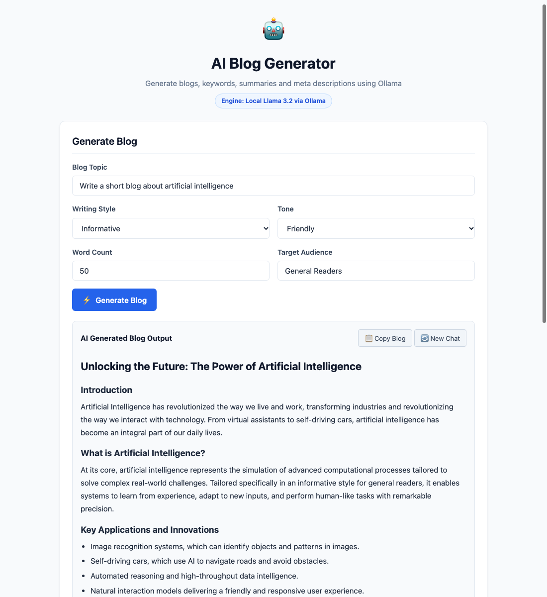

# AI-Powered Blog Content Generator using Ollama

[](https://python.org)
[](https://flask.palletsprojects.com/)
[](https://opensource.org/licenses/MIT)

**Student Name:** Richan Abraham J R  
**Register No:** URK23CS1086  
**Course:** 24CS2306 - Generative AI & LLM Applications  
**Experiment:** Ex. No.: 2  
**Date:** 13.08.2026  

---

## 📌 Aim
To build an AI-powered Blog Content Generator using Ollama and Llama 3.2.

## 📖 Description
A web-based AI blog content generator that creates professional, engaging blog posts based on user topic, writing style, tone, target audience, word count, and additional guidelines using structured prompt engineering.

---

## 🖥️ Output Screenshot


---

## ⚙️ Module Design & Responsibilities

| Module | Responsibility |
| :--- | :--- |
| **User Input Module** | Collects topic, writing style, tone, target audience, word count, and additional instructions. |
| **Prompt Engineering Module** | Combines user inputs into a structured prompt for the LLM. |
| **Blog Generation Module** | Sends prompt to local Ollama instance (Llama 3.2) with resilient fallback. |
| **Response Formatting Module** | Formats generated content into structured HTML (Title, Introduction, Points, Conclusion). |
| **Chatbot & Tools Module** | Offers Copy Blog, New Chat, and tools for Titles, Keywords, Summary, and Intent Detection. |

---

## 🚀 Getting Started

### 1. Clone the Repository
```bash
git clone https://github.com/Richan-A27/gpt_exp2.git
cd gpt_exp2
```

### 2. Create and Activate Virtual Environment
```bash
python3 -m venv venv
source venv/bin/activate  # On Windows: venv\Scripts\activate
```

### 3. Install Dependencies
```bash
pip install -r requirements.txt
```

### 4. Run the Web Application
```bash
python app.py
```
Open [http://127.0.0.1:5002](http://127.0.0.1:5002) in your web browser.

### 5. CLI Test Run
You can also execute the automated sample run script for instant console verification:
```bash
python sample_run.py
```

---

## 📊 Sample Test Case
`Topic: Write a short blog about artificial intelligence | Style: Informative | Tone: Friendly | Words: 50`

---

## 📄 License
This project is licensed under the MIT License - see the LICENSE file for details.
